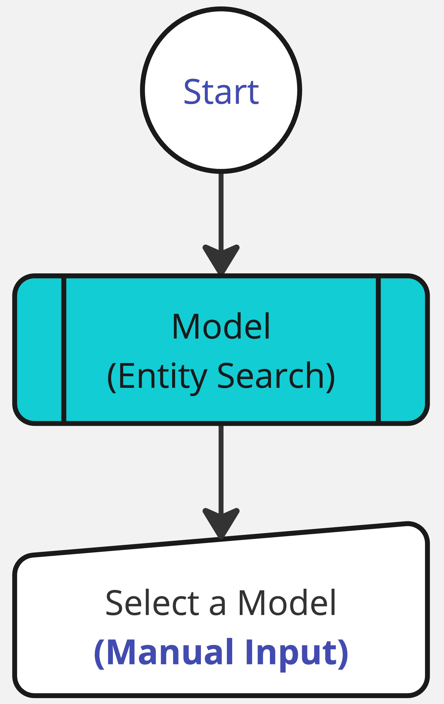
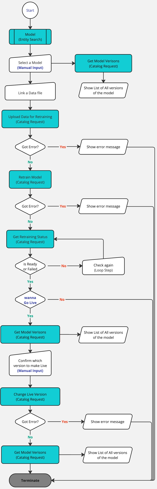

# Krista AI Extension

## Overview

The Krista AI Extension provides programmatic access to Krista's AI model management capabilities through a set of catalog requests. This extension enables you to automate AI model retraining workflows, manage model versions, and monitor training job status—all without manual intervention.

> **Important**: Users must have **workspace admin privileges** to use catalog requests and entities. These requests cannot be used with System Triggered Conversations.

## Key Features

-  **Model Versioning** - Retrieve all versions of a model with performance metrics
-  **Live Version Management** - Switch between available model versions
-  **Dataset Upload** - Stage new training data for model retraining
-  **Retraining Jobs** - Initiate retraining jobs for AI models
-  **Status Tracking** - Monitor the progress of retraining jobs
-  **Automated Retraining** - Build end-to-end automation workflows

## Quick Start Guide

1. **Select an AI Model** - Choose from available AI models in your workspace using entity selection
2. **Upload Dataset** - Stage new data for retraining (CSV format)
3. **Start Retraining** - Trigger a retraining job
4. **Monitor Status** - Track the progress of your retraining job

## Documentation Structure

### Getting Started
- [Authorization Requirements](pages/Authorization.md) - Workspace admin access requirements

### Dataset Management
- [Upload Data for Retraining](pages/UploadDataForRetraining.md) - Stage new data for model retraining

### Model Management
- [Get Model Versions](pages/GetModelVersions.md) - Retrieve all versions of a model
- [Change Live Version](pages/ChangeLiveVersion.md) - Switch the active model version

### Training Operations
- [Retrain Model](pages/RetrainModel.md) - Start a retraining job
- [Get Retraining Status](pages/GetRetrainingStatus.md) - Check retraining job status

### Additional Resources
- [Release Notes](pages/ReleaseNotes.md) - Version history and changes

---

## Problem Statement

A Krista AI model can retrain automatically (if configured) when it has accumulated enough new data, allowing it to improve over time. However, there are limitations with the current approach:

1. **Manual Data Addition**: New data can only be added through executing the "Ask Krista AI" step in a specific way
2. **Model Recreation**: Adding new data often requires deleting the old model and training a new one
3. **Draft Mode Requirement**: Manual changes require the conversation to be in "Draft mode"
4. **External Data Sources**: When new data is collected in external systems (e.g., customer databases), there's no way to trigger retraining without manual intervention

**The Krista AI Extension solves these problems** by providing catalog requests that automate the entire retraining workflow.

---

## Usage Examples

### Selecting an AI Model

Select an AI Model from the list of all models in your workspace using **entity selection**. The Krista AI Extension provides a `Model` entity for this purpose.

### Complete Retraining Workflow

Here's a simple example of how to put the catalog requests together to retrain a Krista AI model:

---

## Model Entity

The extension provides a `Model` entity with the following fields:

| Field | Type | Description |
|-------|------|-------------|
| Model Id | Identifier | Unique identifier for the model |
| Model Name | Text | Human-readable name of the model (searchable) |
| Creation Time | Date | When the model was created |

---

## Retraining Job Status Values

When monitoring retraining jobs, the following status values are possible:

| Status | Description |
|--------|-------------|
| `QUEUED` | Job is waiting to be processed |
| `ANALYZING` | Job is currently processing the data |
| `READY` | Training completed successfully |
| `FAILED` | Training failed; check logs for details |

---

## Support & Resources

| Resource | Value        |
|----------|--------------|
| Extension Version | 1.0.2        |
| Krista Service APIs | 1.0.118      |
| Global Catalog Version | GC-2025.11.5 |
| Java Version | 21           |

---

## See Also

- [Upload Data for Retraining](pages/UploadDataForRetraining.md)
- [Get Model Versions](pages/GetModelVersions.md)
- [Change Live Version](pages/ChangeLiveVersion.md)
- [Retrain Model](pages/RetrainModel.md)
- [Get Retraining Status](pages/GetRetrainingStatus.md)
- [Release Notes](pages/releaseNotes.md)

