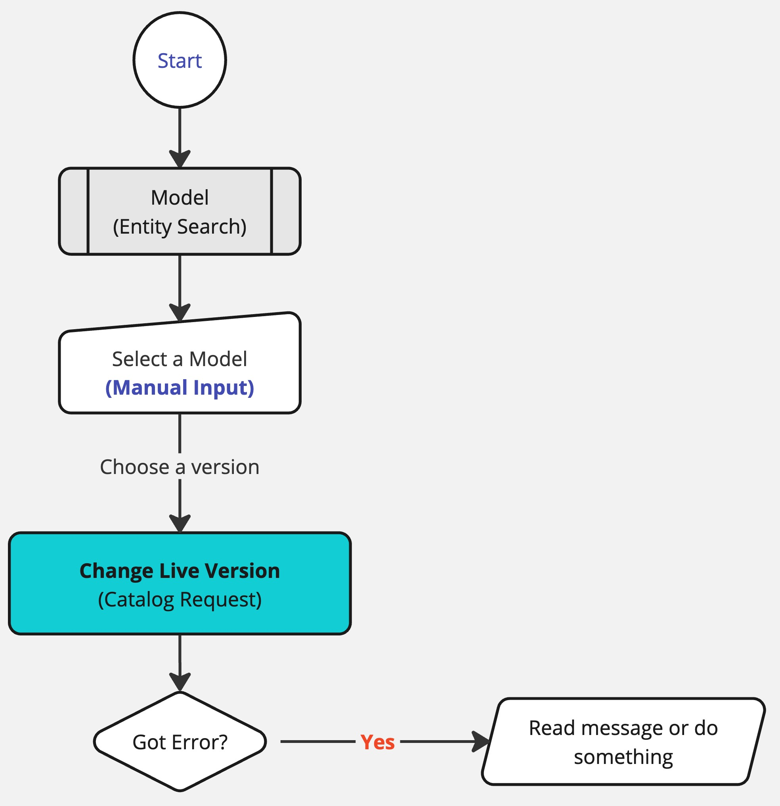

# Change Live Version

## Overview

The **Change Live Version** catalog request allows you to switch the active (live) version of an AI model. This operation changes which model version is used for predictions in production. Only one version can be live at any time.

---

## Request Details

| Property | Value |
|----------|-------|
| Area | Models |
| Type | Change System |
| Retry Support | Yes |

---

## Input Parameters

| Parameter | Type | Required | Description |
|-----------|------|----------|-------------|
| Model Id | Identifier | Yes | The unique identifier of the AI model |
| Target Live Version | Text | Yes | The version name/identifier to make live |

---

## Output Parameters

| Parameter | Type | Description |
|-----------|------|-------------|
| ERROR | Boolean | `true` if an error occurred, `false` otherwise |
| MESSAGE | Text | Success or error message describing the result |

---

## Validation Rules

| Rule | Description | Error Message |
|------|-------------|---------------|
| Model Exists | The specified model must exist in the workspace | "The specified model does not exist. Please verify the Model ID using entity selection or check that the model has not been deleted." |
| Model Accessible | User must have access to the model | "Access denied. You must be a workspace admin to access AI models. Please contact your administrator if you need access." |
| Version Exists | The target version must be a valid version of the model | Version validation error |

---

## Error Handling

### Input Validation Errors
- Missing or invalid Model Id
- Missing or invalid Target Live Version

### Authorization Errors
- User is not a workspace admin

### System Errors
| Error Message | Cause | Resolution |
|---------------|-------|------------|
| "The specified model does not exist. Please verify the Model ID using entity selection or check that the model has not been deleted." | Model ID is invalid or model was deleted | Use entity selection to get a valid Model ID |
| "Unable to fetch model information. Please try again later." | Temporary service unavailability | Wait and retry the operation |
| "An unexpected error occurred while changing the live version." | Internal system error | Check logs and contact support if issue persists |

---

## Usage Examples

### Example 1: Rollback to Previous Version

If a new model version is underperforming, rollback to a previous version:

1. Use [Get Model Versions](pages/GetModelVersions.md) to list available versions
2. Identify the previous stable version from the Version Names output
3. Execute Change Live Version with the target version
4. Verify the change was successful via the MESSAGE output

### Example 2: Promote New Version After Validation

After validating a new model version, promote it to production:

1. Review version performance using [Get Model Versions](pages/GetModelVersions.md)
2. Confirm the new version meets accuracy thresholds
3. Execute Change Live Version to make the new version live
4. Monitor production predictions for any issues

---

## Business Rules

1. **Single Live Version**: Only one version can be live at any time
2. **Immediate Effect**: The change takes effect immediately for all predictions
3. **Version Availability**: Only versions returned by [Get Model Versions](pages/GetModelVersions.md) can be made live
4. **No Automatic Rollback**: If issues occur, you must manually change back to a previous version
5. **Conscious Decision**: This operation is intentionally not automated to ensure human oversight

---

## Limitations

- Only workspace admins can change the live version
- Cannot be used with System Triggered Conversations
- Target version must exist in the model's version history
- No automatic rollback mechanism

---

## Best Practices

1. **Review Before Switching**: Always check version performance with [Get Model Versions](pages/GetModelVersions.md) first
2. **Document Changes**: Record version changes for audit purposes
3. **Monitor After Change**: Watch production predictions after switching versions
4. **Have Rollback Plan**: Know which version to revert to if issues arise
5. **Test in Staging**: If possible, validate the version in a non-production environment first

---

## Common Use Cases

| Use Case | Description |
|----------|-------------|
| Version Rollback | Revert to a previous version if the current one underperforms |
| Gradual Rollout | Switch to a new version after validation |
| A/B Testing Conclusion | Make the winning version live after testing |
| Emergency Fix | Quickly switch to a known-good version during incidents |

---

## Related Catalog Requests

- [Get Model Versions](pages/GetModelVersions.md) - View available versions before switching
- [Retrain Model](pages/RetrainModel.md) - Create a new model version
- [Get Retraining Status](pages/GetRetrainingStatus.md) - Check if new version is ready

---

## Technical Implementation

| Component | Details |
|-----------|---------|
| Implementation Class | `ModelsArea` |
| Telemetry Operation | `changeLiveVersion` |
| Service Dependency | `AiModel` |

---

## Troubleshooting

| Issue | Possible Cause | Solution |
|-------|----------------|----------|
| Version not found | Invalid version name | Use Get Model Versions to list valid versions |
| Access denied | User lacks workspace admin role | Request workspace admin access |
| Model not found | Invalid model ID | Verify model exists using entity selection |
| Change not taking effect | Caching or propagation delay | Wait a few moments and verify again |

---

## See Also

- [Authorization Requirements](pages/Authorization.md)
- [Get Model Versions](pages/GetModelVersions.md)
- [Retrain Model](pages/RetrainModel.md)
- [Release Notes](pages/releaseNotes.md)

