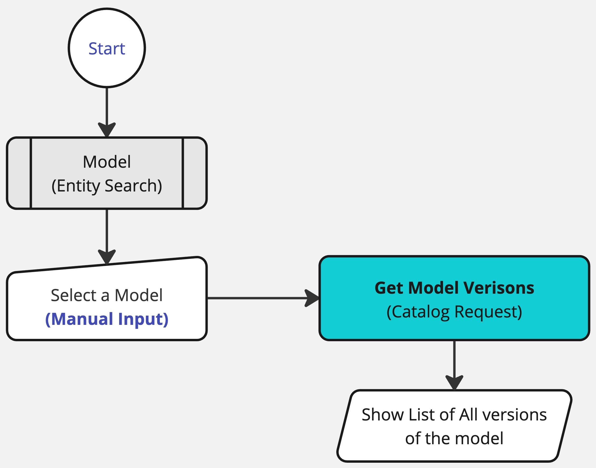
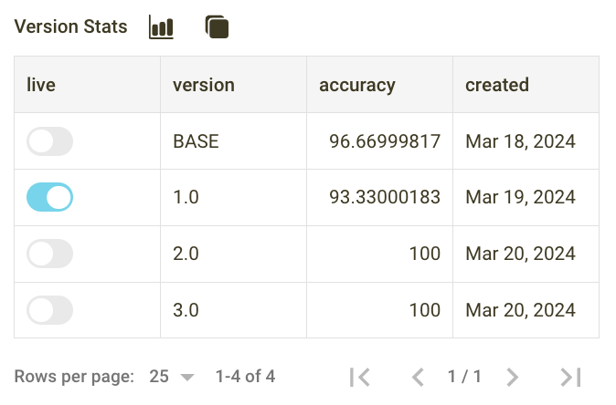

# Get Model Versions

## Overview

The **Get Model Versions** catalog request retrieves all available versions of an AI model along with their performance statistics. Krista AI maintains up to 6 versions of each model, allowing you to compare performance and select the best version to make live.

---

## Request Details

| Property | Value |
|----------|-------|
| Area | Models |
| Type | Query System |
| Retry Support | Yes |

---

## Input Parameters

| Parameter | Type | Required | Description |
|-----------|------|----------|-------------|
| Model Id | Identifier | Yes | The unique identifier of the AI model |

---

## Output Parameters

| Parameter | Type | Description |
|-----------|------|-------------|
| Version Stats | List | Performance statistics for each model version |
| Version Names | List | Names/identifiers of all available versions |
| ERROR | Boolean | `true` if an error occurred, `false` otherwise |
| MESSAGE | Text | Success or error message describing the result |

---

## Validation Rules

| Rule | Description | Error Message |
|------|-------------|---------------|
| Model Exists | The specified model must exist in the workspace | "The specified model does not exist. Please verify the Model ID using entity selection or check that the model has not been deleted." |
| Model Accessible | User must have access to the model | "Access denied. You must be a workspace admin to access AI models. Please contact your administrator if you need access." |

---

## Error Handling

### Input Validation Errors
- Missing or invalid Model Id

### Authorization Errors
- User is not a workspace admin

### System Errors
| Error Message | Cause | Resolution |
|---------------|-------|------------|
| "The specified model does not exist. Please verify the Model ID using entity selection or check that the model has not been deleted." | Model ID is invalid or model was deleted | Use entity selection to get a valid Model ID |
| "Unable to fetch model information. Please try again later." | Temporary service unavailability | Wait and retry the operation |
| "An unexpected error occurred while fetching model versions." | Internal system error | Check logs and contact support if issue persists |

---

## Usage Examples

### Example 1: Review Model Performance

Check the performance of all versions before deciding which to make live:

1. Select the target AI model using entity selection
2. Execute the Get Model Versions request
3. Review the Version Stats output for accuracy metrics
4. Identify the best-performing version

### Example 2: Version Comparison Workflow

Create a workflow to compare versions and notify stakeholders:

1. Retrieve all model versions
2. Parse the Version Stats to extract accuracy metrics
3. Compare against performance thresholds
4. Send notification if a newer version outperforms the current live version

---

## Business Rules

1. **Version Retention**: Krista AI keeps up to 6 past versions of each model (including the original)
2. **Single Live Version**: Only one version can be live at any time
3. **Performance Metrics**: Each version includes test data performance statistics
4. **Read-Only Operation**: This request does not modify any model data

---

## Limitations

- Maximum of 6 versions are retained per model
- Only workspace admins can access version information
- Cannot be used with System Triggered Conversations
- Historical versions older than the 6 most recent are not available

---

## Best Practices

1. **Regular Monitoring**: Periodically check version performance to ensure optimal model accuracy
2. **Document Decisions**: Record why specific versions were chosen to go live
3. **Compare Before Switching**: Always review version stats before using [Change Live Version](pages/ChangeLiveVersion.md)
4. **Automate Alerts**: Set up workflows to alert when new versions are available

---

## Common Use Cases

| Use Case | Description |
|----------|-------------|
| Performance Monitoring | Track model accuracy across versions |
| Version Selection | Choose the best version to make live |
| Regression Detection | Identify if newer versions perform worse |
| Audit Trail | Document version history for compliance |

---

## Related Catalog Requests

- [Change Live Version](pages/ChangeLiveVersion.md) - Switch to a different model version
- [Retrain Model](pages/RetrainModel.md) - Create a new model version
- [Upload Data for Retraining](pages/UploadDataForRetraining.md) - Add training data

---

## Technical Implementation

| Component | Details |
|-----------|---------|
| Implementation Class | `ModelsArea` |
| Telemetry Operation | `listModelVersions` |
| Service Dependency | `AiModel` |

---

## Troubleshooting

| Issue | Possible Cause | Solution |
|-------|----------------|----------|
| No versions returned | Model has no trained versions | Train the model first |
| Access denied | User lacks workspace admin role | Request workspace admin access |
| Model not found | Invalid model ID | Verify model exists using entity selection |
| Unexpected error | Service temporarily unavailable | Wait and retry; check system status |

---

## See Also

- [Authorization Requirements](pages/Authorization.md)
- [Change Live Version](pages/ChangeLiveVersion.md)
- [Retrain Model](pages/RetrainModel.md)
- [Release Notes](pages/releaseNotes.md)

