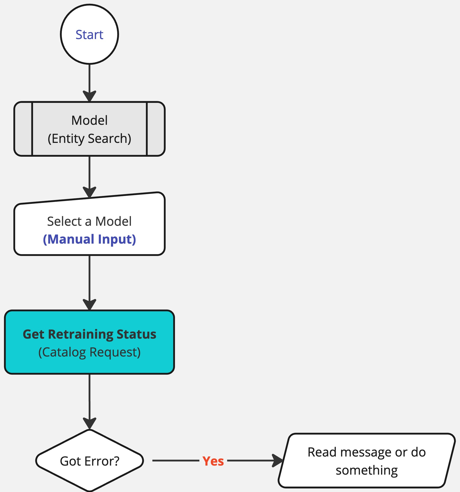

# Get Retraining Status

## Overview

The **Get Retraining Status** catalog request retrieves the current status of a retraining job. Use this request to monitor the progress of jobs initiated by [Retrain Model](pages/RetrainModel.md) and determine when a new model version is ready.



---

## Request Details

| Property | Value |
|----------|-------|
| Area | Training |
| Type | Change System |
| Retry Support | Yes |

---

## Input Parameters

| Parameter | Type | Required | Description |
|-----------|------|----------|-------------|
| Model Id | Identifier | Yes | The unique identifier of the AI model |
| Retraining Job Id | Text | Yes | The job ID returned by [Retrain Model](pages/RetrainModel.md) |

---

## Output Parameters

| Parameter | Type | Description |
|-----------|------|-------------|
| STATUS | Text | Current status of the retraining job |
| ERROR | Boolean | `true` if an error occurred, `false` otherwise |
| MESSAGE | Text | Success or error message describing the result |

---

## Status Values

| Status | Description | Next Action |
|--------|-------------|-------------|
| `QUEUED` | Job is waiting to be processed | Continue polling |
| `ANALYZING` | Job is actively processing training data | Continue polling |
| `READY` | Training completed successfully | New version is available |
| `FAILED` | Training failed | Check logs; may need to retry |
| `Unknown` | Status could not be determined | Verify job ID; contact support |

---

## Validation Rules

| Rule | Description | Error Message |
|------|-------------|---------------|
| Model Exists | The specified model must exist in the workspace | "The specified model does not exist. Please verify the Model ID using entity selection or check that the model has not been deleted." |
| Model Accessible | User must have access to the model | "Access denied. You must be a workspace admin to access AI models. Please contact your administrator if you need access." |
| Valid Job Id | The job ID must be valid for the specified model | Status check error |

---

## Error Handling

### Input Validation Errors
- Missing or invalid Model Id
- Missing or invalid Retraining Job Id

### Authorization Errors
- User is not a workspace admin

### System Errors
| Error Message | Cause | Resolution |
|---------------|-------|------------|
| "The specified model does not exist. Please verify the Model ID using entity selection or check that the model has not been deleted." | Model ID is invalid or model was deleted | Use entity selection to get a valid Model ID |
| "Unable to fetch model information. Please try again later." | Temporary service unavailability | Wait and retry the operation |
| "An unexpected error occurred while fetching the retraining status." | Internal system error | Check logs and contact support if issue persists |

---

## Usage Examples

### Example 1: Simple Status Check

Check the status of a retraining job:

1. Store the Retraining Job Id from [Retrain Model](pages/RetrainModel.md)
2. Execute Get Retraining Status with Model Id and Job Id
3. Read the STATUS output
4. Take action based on the status value

### Example 2: Polling Loop

Implement a polling workflow to wait for completion:

1. Start retraining with [Retrain Model](pages/RetrainModel.md)
2. Store the returned Job Id
3. Loop:
   - Call Get Retraining Status
   - If STATUS is READY or FAILED, exit loop
   - Wait (e.g., 30 seconds) before next check
4. Handle the final status appropriately

### Example 3: Notification Workflow

Send notifications based on retraining completion:

1. Poll for status until READY or FAILED
2. If READY:
   - Get new version details with [Get Model Versions](pages/GetModelVersions.md)
   - Send success notification with performance metrics
3. If FAILED:
   - Send failure notification with error details
   - Log for investigation

---

## Business Rules

1. **Job Persistence**: Job status remains available after completion
2. **Status Progression**: Jobs typically progress from QUEUED → ANALYZING → READY/FAILED
3. **No Status Modification**: This request only reads status; it cannot modify the job
4. **Model Association**: Job ID must correspond to the specified model

---

## Limitations

- Only workspace admins can check retraining status
- Cannot be used with System Triggered Conversations
- Job ID must be from the same model specified
- Historical job information may have retention limits

---

## Best Practices

1. **Implement Polling**: Use a loop with appropriate delays to check status
2. **Set Timeouts**: Define maximum wait times for long-running jobs
3. **Handle All Statuses**: Implement logic for each possible status value
4. **Log Status Changes**: Record status transitions for debugging
5. **Graceful Failure Handling**: Have a plan for FAILED status

---

## Common Use Cases

| Use Case | Description |
|----------|-------------|
| Progress Monitoring | Track retraining job progress in real-time |
| Completion Detection | Determine when a new version is ready |
| Failure Detection | Identify and respond to failed retraining jobs |
| Workflow Orchestration | Coordinate subsequent actions based on status |

---

## Related Catalog Requests

- [Retrain Model](pages/RetrainModel.md) - Initiate retraining and get job ID
- [Get Model Versions](pages/GetModelVersions.md) - View new version after READY status
- [Change Live Version](pages/ChangeLiveVersion.md) - Promote new version after validation
- [Upload Data for Retraining](pages/UploadDataForRetraining.md) - Add data before retraining

---

## Technical Implementation

| Component | Details |
|-----------|---------|
| Implementation Class | `TrainingArea` |
| Telemetry Operation | `retrainingStatus` |
| Service Dependency | `AiModel` |

---

## Status Flow Diagram

```
┌─────────┐     ┌───────────┐     ┌─────────┐
│ QUEUED  │ ──► │ ANALYZING │ ──► │  READY  │
└─────────┘     └───────────┘     └─────────┘
                      │
                      ▼
                ┌──────────┐
                │  FAILED  │
                └──────────┘
```

---

## Polling Recommendations

| Scenario | Recommended Interval | Max Wait Time |
|----------|---------------------|---------------|
| Small dataset | 15-30 seconds | 10 minutes |
| Medium dataset | 30-60 seconds | 30 minutes |
| Large dataset | 1-2 minutes | 2 hours |

---

## Troubleshooting

| Issue | Possible Cause | Solution |
|-------|----------------|----------|
| Unknown status | Invalid job ID | Verify job ID from Retrain Model response |
| Access denied | User lacks workspace admin role | Request workspace admin access |
| Model not found | Invalid model ID | Verify model exists using entity selection |
| Status stuck | System processing delay | Wait longer; contact support if prolonged |
| FAILED status | Training error | Check logs; ensure data quality; retry |

---

## See Also

- [Authorization Requirements](pages/Authorization.md)
- [Retrain Model](pages/RetrainModel.md)
- [Get Model Versions](pages/GetModelVersions.md)
- [Release Notes](pages/releaseNotes.md)

