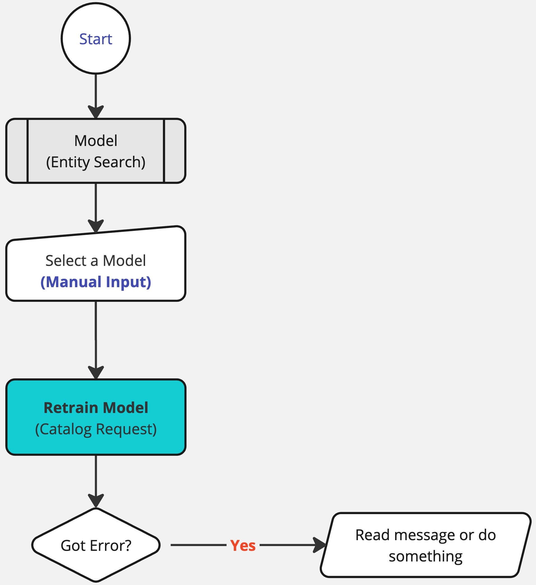

# Retrain Model

## Overview

The **Retrain Model** catalog request initiates a retraining job for an AI model. This creates a new model version using the accumulated training data. The retraining job runs asynchronously, and you can monitor its progress using [Get Retraining Status](pages/GetRetrainingStatus.md).



---

## Request Details

| Property | Value |
|----------|-------|
| Area | Training |
| Type | Change System |
| Retry Support | Yes |

---

## Input Parameters

| Parameter | Type | Required | Description |
|-----------|------|----------|-------------|
| Model Id | Identifier | Yes | The unique identifier of the AI model to retrain |

---

## Output Parameters

| Parameter | Type | Description |
|-----------|------|-------------|
| Retraining Job Id | Text | Unique identifier for the queued retraining job |
| ERROR | Boolean | `true` if an error occurred, `false` otherwise |
| MESSAGE | Text | Success or error message describing the result |

---

## Validation Rules

| Rule | Description | Error Message |
|------|-------------|---------------|
| Model Exists | The specified model must exist in the workspace | "The specified model does not exist. Please verify the Model ID using entity selection or check that the model has not been deleted." |
| Model Accessible | User must have access to the model | "Access denied. You must be a workspace admin to access AI models. Please contact your administrator if you need access." |
| New Data Available | There must be new training data available | Job will not be created if no new data exists |

---

## Error Handling

### Input Validation Errors
- Missing or invalid Model Id

### Authorization Errors
- User is not a workspace admin

### Logic Errors
- No new training data available for retraining

### System Errors
| Error Message | Cause | Resolution |
|---------------|-------|------------|
| "The specified model does not exist. Please verify the Model ID using entity selection or check that the model has not been deleted." | Model ID is invalid or model was deleted | Use entity selection to get a valid Model ID |
| "Unable to fetch model information. Please try again later." | Temporary service unavailability | Wait and retry the operation |
| "An unexpected error occurred while starting the retraining job." | Internal system error | Check logs and contact support if issue persists |

---

## Usage Examples

### Example 1: Manual Retraining After Data Upload

Trigger retraining after uploading new training data:

1. Upload new data using [Upload Data for Retraining](pages/UploadDataForRetraining.md)
2. Execute Retrain Model with the model ID
3. Store the returned Retraining Job Id
4. Monitor progress with [Get Retraining Status](pages/GetRetrainingStatus.md)

### Example 2: Scheduled Retraining Workflow

Create an automated weekly retraining workflow:

1. Schedule a conversation to run weekly
2. Execute Retrain Model for target models
3. Store job IDs for tracking
4. Send notification when retraining completes
5. Review new version performance

### Example 3: Complete Retraining Pipeline

End-to-end automation from data collection to version promotion:

1. Collect new data from external sources
2. Upload data using [Upload Data for Retraining](pages/UploadDataForRetraining.md)
3. Trigger retraining with this request
4. Poll status until READY using [Get Retraining Status](pages/GetRetrainingStatus.md)
5. Compare versions using [Get Model Versions](pages/GetModelVersions.md)
6. Optionally promote with [Change Live Version](pages/ChangeLiveVersion.md)

---

## Business Rules

1. **New Data Required**: A retraining job will not be created if there is no new training data available
2. **Asynchronous Processing**: Retraining runs in the background; use the job ID to track progress
3. **Version Creation**: Successful retraining creates a new model version
4. **Version Limit**: Krista AI maintains up to 6 versions; older versions may be removed
5. **No Automatic Promotion**: New versions are not automatically made live

---

## Limitations

- Only workspace admins can initiate retraining
- Cannot be used with System Triggered Conversations
- Retraining requires new data to be available
- Only one retraining job can run per model at a time
- Job duration depends on data volume and model complexity

---

## Best Practices

1. **Ensure Data Availability**: Upload new data before triggering retraining
2. **Store Job ID**: Always save the Retraining Job Id for status tracking
3. **Implement Polling**: Create a loop to check status until completion
4. **Handle Failures**: Implement error handling for failed retraining jobs
5. **Validate Results**: Review new version performance before making it live

---

## Common Use Cases

| Use Case | Description |
|----------|-------------|
| Scheduled Retraining | Weekly or monthly model updates |
| Data-Driven Retraining | Trigger retraining when sufficient new data is available |
| Model Improvement | Retrain with corrected or enhanced training data |
| Continuous Learning | Automate ongoing model improvement |

---

## Related Catalog Requests

- [Upload Data for Retraining](pages/UploadDataForRetraining.md) - Add training data before retraining
- [Get Retraining Status](pages/GetRetrainingStatus.md) - Monitor retraining progress
- [Get Model Versions](pages/GetModelVersions.md) - View the new version after retraining
- [Change Live Version](pages/ChangeLiveVersion.md) - Promote the new version

---

## Technical Implementation

| Component | Details |
|-----------|---------|
| Implementation Class | `TrainingArea` |
| Telemetry Operation | `retrainModel` |
| Service Dependency | `AiModel` |

---

## Retraining Job Lifecycle

```
QUEUED → ANALYZING → READY (success)
                  ↘ FAILED (error)
```

| Status | Description |
|--------|-------------|
| QUEUED | Job is waiting to be processed |
| ANALYZING | Job is actively processing training data |
| READY | Training completed successfully; new version available |
| FAILED | Training failed; check logs for details |

---

## Troubleshooting

| Issue | Possible Cause | Solution |
|-------|----------------|----------|
| No job ID returned | No new data available | Upload data first using Upload Data for Retraining |
| Access denied | User lacks workspace admin role | Request workspace admin access |
| Model not found | Invalid model ID | Verify model exists using entity selection |
| Job stuck in QUEUED | System resource constraints | Wait for resources; contact support if prolonged |

---

## See Also

- [Authorization Requirements](pages/Authorization.md)
- [Upload Data for Retraining](pages/UploadDataForRetraining.md)
- [Get Retraining Status](pages/GetRetrainingStatus.md)
- [Release Notes](pages/releaseNotes.md)

