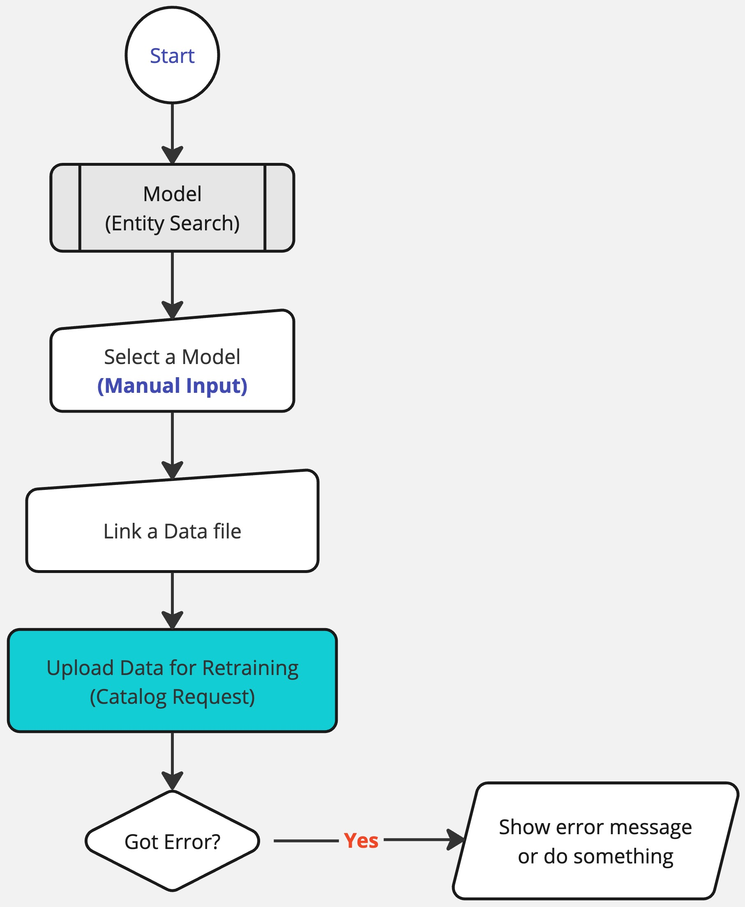

# Upload Data for Retraining

## Overview

The **Upload Data for Retraining** catalog request allows you to stage new training data for an AI model. This data will be used when the model is retrained, either automatically (if auto-retraining is enabled) or manually via the [Retrain Model](pages/RetrainModel.md) request.

---

## Request Details

| Property | Value |
|----------|-------|
| Area | Datasets |
| Type | Change System |
| Retry Support | Yes |

---

## Input Parameters

| Parameter | Type | Required | Description |
|-----------|------|----------|-------------|
| Model Id | Identifier | Yes | The unique identifier of the AI model to upload data for |
| File | File | Yes | The training data file (CSV format) |

---

## Output Parameters

| Parameter | Type | Description |
|-----------|------|-------------|
| ERROR | Boolean | `true` if an error occurred, `false` otherwise |
| MESSAGE | Text | Success or error message describing the result |
| STATUS | Text | Status of the upload operation |

---

## Validation Rules

| Rule | Description | Error Message |
|------|-------------|---------------|
| Model Exists | The specified model must exist in the workspace | "The specified model does not exist. Please verify the Model ID using entity selection or check that the model has not been deleted." |
| Model Accessible | User must have access to the model | "Access denied. You must be a workspace admin to access AI models. Please contact your administrator if you need access." |
| File Required | A valid file must be provided | Input validation error |

---

## Error Handling

### Input Validation Errors
- Missing or invalid Model Id
- Missing or invalid file

### Authorization Errors
- User is not a workspace admin

### System Errors
| Error Message | Cause | Resolution |
|---------------|-------|------------|
| "The specified model does not exist. Please verify the Model ID using entity selection or check that the model has not been deleted." | Model ID is invalid or model was deleted | Use entity selection to get a valid Model ID |
| "Unable to fetch model information. Please try again later." | Temporary service unavailability | Wait and retry the operation |
| "An unexpected error occurred while uploading the dataset." | Internal system error | Check logs and contact support if issue persists |

---

## Usage Examples

### Example 1: Upload Training Data from File Variable

Upload a CSV file containing new training data for a classification model:

1. Select the target AI model using entity selection
2. Provide the training data file (from a file variable or file upload)
3. Execute the catalog request
4. Check the STATUS output for confirmation

### Example 2: Automated Data Pipeline

Combine with other extensions to create an automated data pipeline:

1. Use a database extension to export new records
2. Transform data into the required CSV format
3. Use this catalog request to upload the data
4. Optionally trigger retraining with [Retrain Model](pages/RetrainModel.md)

---

## Business Rules

1. **Data Staging**: Uploaded data is staged for the next retraining job; it does not immediately affect the live model
2. **Auto-Retraining**: If auto-retraining is enabled for the model, uploading sufficient data may automatically trigger retraining
3. **Data Accumulation**: Multiple uploads accumulate data until a retraining job processes it
4. **File Format**: The file must be in a format compatible with the model's training requirements

---

## Limitations

- Maximum file size depends on system configuration
- Only workspace admins can upload data
- Cannot be used with System Triggered Conversations
- Data format must match the model's expected input schema

---

## Best Practices

1. **Validate Data Format**: Ensure your CSV file matches the model's expected schema before uploading
2. **Batch Uploads**: Combine multiple data points into a single file rather than uploading individually
3. **Monitor Status**: Always check the STATUS output to confirm successful upload
4. **Error Handling**: Implement error handling in your workflow to manage upload failures

---

## Common Use Cases

| Use Case | Description |
|----------|-------------|
| External Data Integration | Import training data from external databases or systems |
| Manual Data Correction | Upload corrected or curated training examples |
| Scheduled Data Updates | Automate periodic data uploads from data warehouses |
| A/B Testing Data | Stage different datasets for model comparison |

---

## Related Catalog Requests

- [Retrain Model](pages/RetrainModel.md) - Start a retraining job after uploading data
- [Get Retraining Status](pages/GetRetrainingStatus.md) - Monitor retraining progress
- [Get Model Versions](pages/GetModelVersions.md) - View model versions after retraining

---

## Technical Implementation

| Component | Details |
|-----------|---------|
| Implementation Class | `DatasetsArea` |
| Telemetry Operation | `uploadDataForRetraining` |
| Service Dependency | `AiDataset` |

---

## Troubleshooting

| Issue | Possible Cause | Solution |
|-------|----------------|----------|
| Upload fails with access error | User lacks workspace admin role | Request workspace admin access |
| Model not found | Invalid model ID | Verify model exists using entity selection |
| File upload error | File format or size issue | Check file format and size limits |
| Unexpected error | Service temporarily unavailable | Wait and retry; check system status |

---

## See Also

- [Authorization Requirements](pages/Authorization.md)
- [Retrain Model](pages/RetrainModel.md)
- [Get Model Versions](pages/GetModelVersions.md)
- [Release Notes](pages/releaseNotes.md)

